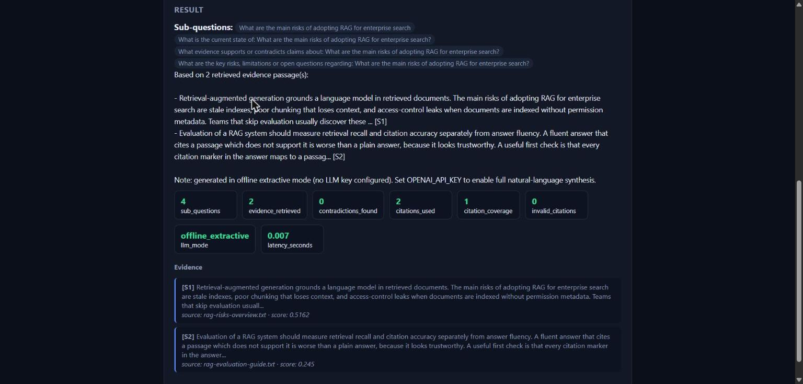

# ResearchPilot AI

[](https://github.com/Sanchitrana448/researchpilot-ai/actions/workflows/ci.yml) [](LICENSE)

Live: https://researchpilot-ai-yw7y.onrender.com  
*(free tier, so it may take ~50s to wake outside weekday daytime)*

**Try it in one click:** open the live demo and press "Load sample corpus and run an example".

Ask a research question against a set of documents and get back an answer where every claim points to a specific passage. If the evidence is thin or the sources disagree, it says so instead of papering over it.

Works with no API key at all. Without one it falls back to extractive synthesis, which stitches together retrieved passages with citations rather than generating prose. Set `OPENAI_API_KEY` and it switches to LLM synthesis on the next request, no code change.

## Screenshots


*Offline extractive mode on the built-in sample corpus: every `[Sx]` marker maps to retrieved evidence, so `invalid_citations` is 0.*

## The part I actually care about

Most RAG demos will happily cite `[S3]` when there is no S3. The synthesis step here is untrusted by design: after the answer comes back, a validator pulls every `[Sx]` marker out of the text and checks it against the evidence that was actually retrieved. Anything that doesn't match gets flagged in `uncertainty_notes` and counted in `invalid_citations`.

The offline path can't fabricate a citation at all, since it only ever emits text it pulled from the corpus. That's the main reason I kept it as a real mode rather than a stub.

## Pipeline

```
question
  -> planner            decompose into 3-5 sub-questions
  -> retrieval          bge-small embeddings + Qdrant vector search
  -> re-ranking         cross-encoder re-scores the top 30 candidates
  -> evidence           rank and label passages [S1..Sn]
  -> critic             scan evidence pairs for contradictions
  -> synthesis          cited answer (LLM, or extractive fallback)
  -> citation validator verify every [Sx] maps to real evidence
  -> quality control    uncertainty notes, coverage, latency
```

Each stage is a plain function returning a dict, so you can inspect the whole trace from the API response.

## Running it

```bash
pip install -r requirements.txt
uvicorn app.main:app --reload
```

The first start downloads two ONNX models (about 160 MB) from the Hugging Face hub into `.model_cache/`; later starts reuse them. `python -m app.download_models` fetches them ahead of time, and the Docker build does this for you.

Then open http://localhost:8000. Docker works too:

```bash
docker build -t researchpilot .
docker run -p 8000:8000 researchpilot
```

## API

| Method | Endpoint | Purpose |
|---|---|---|
| `POST` | `/ingest/text` | Add raw text to the corpus |
| `POST` | `/ingest/file` | Upload a `.pdf`/`.txt`/`.md` |
| `POST` | `/research` | Run the pipeline on a question |
| `GET` | `/research/{id}` | Fetch a past result |
| `GET` | `/research` | List past results |
| `GET` | `/corpus/stats` | Document and chunk counts |
| `POST` | `/sample` | Load the built-in demo corpus (idempotent) |
| `GET` | `/health` | Liveness and corpus stats |

Swagger docs at `/docs`.

## Retrieval details

**Vector search, measured on a public benchmark.** Every chunk is embedded once at ingest with [bge-small-en-v1.5](https://huggingface.co/BAAI/bge-small-en-v1.5) (384 dimensions, quantised ONNX on CPU) and stored in a [Qdrant](https://qdrant.tech/) collection. A question is embedded with BGE's retrieval instruction and matched by cosine similarity.

On [BEIR SciFact](https://github.com/beir-cellar/beir) (5,183 scientific abstracts, 300 expert-labelled test queries):

| Pipeline | NDCG@10 | Recall@100 | ms / query |
|---|---|---|---|
| BM25 keyword baseline | 0.652 | 0.873 | 15 |
| **bge-small + Qdrant (this app)** | **0.706 (+8.2%)** | **0.943** | **19** |
| + cross-encoder re-rank of top 30 | 0.701 | 0.943 | 2,743 |

The bge-small score is close to the 0.713 published for the same model, and the BM25 score to the 0.665 in the BEIR paper, so the evaluation setup checks out. Reproduce with `python eval/beir_scifact.py`; full tables in [RESULTS.md](RESULTS.md).

**Re-ranking was tested and is off by default.** A cross-encoder (ms-marco-MiniLM-L-6-v2) re-scoring the top 30 candidates did not beat vector search alone on SciFact, at about 140 times the latency and about 140 MB more memory. It is still available locally with `{"rerank": true}`; on Render's 512 MB free tier it is refused rather than risking an out-of-memory crash.

**Refusing off-topic questions.** Passages below a cosine similarity of 0.50 are dropped, and so are passages more than 0.15 below the best match. An unrelated question therefore retrieves nothing and the pipeline says there is not enough evidence instead of citing the least-bad passage. On a hand-written check, all 6 off-topic questions were refused while all 24 keyword questions still found their passage first.

Two more things that aren't obvious from the endpoint list:

**Duplicate chunks are dropped at ingest.** If the same paragraph appears in two uploaded documents, it gets indexed once. Without this, quoting the same passage twice looks like two independent sources agreeing, which inflates apparent confidence for no reason.

**Ranking isn't just cosine similarity.** It over-fetches `top_k * 3` candidates, then orders them by `0.85 * relevance + 0.15 * source_quality`, where source quality is a crude heuristic on the source name (`.gov`/`.edu`/arxiv score higher than an anonymous paste). Swapping that for a real domain-authority or recency model is a drop-in change.

## Tests

```bash
pytest tests/ -v
```

Fourteen tests: chunk windowing and overlap, index add/search, duplicate deduplication, the full offline pipeline end to end, the zero-document case (which should return no evidence and refuse to answer, not hallucinate), the sample endpoint being idempotent, every eval question retrieving its expected source with zero invalid citations, the contradiction critic ignoring stopword-only overlap, vector search finding a reworded question that shares no words with its passage, off-topic questions retrieving nothing, the re-ranker adding its score, the API reporting the models and honouring the `rerank` flag, and re-ranking being refused where memory does not allow it.

## Evaluation

```bash
pip install -r requirements-bench.txt
python eval/beir_scifact.py   # public benchmark, ~15-30 min on a laptop CPU
python eval/run_eval.py       # pipeline eval + paraphrase check, writes RESULTS.md
```

`beir_scifact.py` downloads BEIR SciFact from the Hugging Face hub and scores BM25, vector search, and vector search + re-ranking with NDCG@10, Recall@10 and Recall@100. `run_eval.py` runs the 8-question pipeline eval (CI fails on any invalid citation), the paraphrase and refusal check, and collects everything into [RESULTS.md](RESULTS.md).

## Limitations

- Vector search can still miss a reworded question: on the hand-written paraphrase set, the right passage is ranked first about 6 times in 10 and in the top three about 9 times in 10.
- The cross-encoder re-ranker (trained on web search queries) helped on neither SciFact nor the paraphrase set, and it scores reworded but correct matches almost as low as off-topic ones. A re-ranker trained on scientific text would be the next thing to try.
- The similarity floor for refusing off-topic questions was chosen on a small hand-written set.
- The contradiction detector is a negation heuristic: it looks for evidence pairs sharing 6+ terms where one contains a negation word and the other doesn't. It catches blunt "X causes Y" vs "X does not cause Y" pairs and nothing subtler. It's deliberately tuned to be quiet rather than thorough, since a noisy critic is worse than none.
- The index is in-memory. Restart and the corpus is gone; Qdrant's server mode would fix that with a constructor change.
- The contradiction critic once flagged pairs that only shared words like "a", "and" and "of"; the eval caught it and it now counts content words only.
- Source-quality scoring is a hardcoded domain list, not a real model.

## Stack

Python, FastAPI, Qdrant (vector database), bge-small-en-v1.5 embeddings and an ms-marco MiniLM cross-encoder run as ONNX through fastembed, pypdf, Pydantic, Docker, pytest. The LLM layer targets the OpenAI Chat Completions shape, so any compatible endpoint works.
